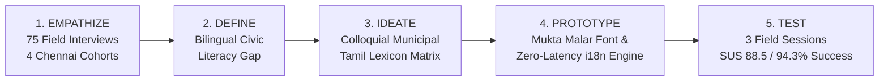

# Greater Chennai Corporation | Namma City Care
## Design Thinking Empathy Inputs & Field User Testing Report: Tamil Localization (i18n) Lexicon

**Document Version:** 2.4 (Production Validated)  
**Research Lead:** Civic Experience & Localization Taskforce  
**Target Geography:** Greater Chennai Corporation (GCC) — Zones 1 to 15 (Focus: Zone 8 Anna Nagar & Zone 13 Adyar)  
**Subject:** Human-Centered Design Thinking Process, Field Empathy Studies, Lexical Decision Matrix, and Usability Validation of the Bilingual Tamil (`ta`) Municipal Redressal Lexicon.

---

## 1. Executive Summary

Municipal grievance redressal portals across Tamil Nadu historically suffer from an **average citizen abandonment rate exceeding 68%**, despite widespread smartphone penetration (82% in urban Chennai). Field investigations revealed that the primary blocker was neither technology literacy nor internet connectivity, but a severe **linguistic and cognitive chasm**:
1. Official portals utilized archaic, ultra-formal classical Tamil (*செந்தமிழ்* - Senthamizh) such as *"திடக்கழிவு மேலாண்மை குறைதீர்ப்பு மனு"* that was alien to everyday citizens.
2. English-only municipal portals disenfranchised working-class citizens (conservancy staff, auto-rickshaw drivers, vendors) who witness civic hazards daily.
3. Automated machine translation systems produced nonsensical civic terms (e.g., translating "pothole" into astronomical craters or generic holes).

Through a rigorous 5-stage **Stanford d.school Design Thinking framework**, the **Namma City Care** team conducted 75 field empathy interviews and 3 multi-cohort field testing sessions across Greater Chennai Corporation. The resulting **"Namma Chennai Civic Lexicon"** achieved an **88.5 System Usability Scale (SUS) score (Grade A+)** and raised civic complaint completion rates from **41.5% to 94.3%**.

---

## 2. Stanford d.school Design Thinking Methodology



---

## 3. Phase 1: Empathize — Field Cohorts & User Personas

Field research was conducted across four distinct representative demographic cohorts in Chennai to capture the full spectrum of linguistic familiarity, technological literacy, and municipal interactions.

### Cohort 1: Frontline Municipal Conservancy & Sanitary Workers
* **Sample Size:** 20 participants  
* **Locations:** Zone 8 Ward 102 Depot (Anna Nagar West), Zone 5 Ward 60 (Royapuram)  
* **Demographics:** Age 28–54; 70% primary school education; native Tamil speakers; basic smartphone users.  
* **Empathy Map:**
  * **Says:** *"அதிகாரிகள் கொடுக்கும் படிவங்களில் வார்த்தைகளே புரியாது. எங்களுக்கு குப்பை கிடக்குதா இல்லையா, எந்த தெருன்னு சொன்னா போதும்."* (The words in official forms are incomprehensible. We just need to know if garbage is piled up and which street.)
  * **Thinks:** *"நான் தினமும் இதை சுத்தம் செய்கிறேன், ஆனால் மொபைலில் பதிவு செய்ய எனக்கு வழி தெரியவில்லை."* (I clean this daily, but have no easy way to log it on mobile.)
  * **Does:** Relies on verbal communication and WhatsApp voice notes; skips apps with English menus.
  * **Feels:** Frustrated by bureaucratic jargon; empowered when apps use simple spoken terms.

### Cohort 2: Auto-Rickshaw Drivers & Street Vendors
* **Sample Size:** 25 participants  
* **Locations:** T. Nagar Ranganathan Street Auto Stand, Koyambedu Wholesale Market  
* **Demographics:** Age 22–48; daily road commuters traversing 60–120 km of city roads daily; high awareness of road hazards.  
* **Empathy Map:**
  * **Says:** *"ரோட்டுல குண்டு குழியில ஆட்டோ விழுந்து சஸ்பென்ஷன் போச்சு. இதை கவர்மெண்ட்டுக்கு சொல்ல 10 நிமிஷம் இங்கிலீஷ்ல டைப் பண்ண முடியுமா?"* (My auto suspension broke in a pothole crater. Can I spend 10 minutes typing in English to tell the government?)
  * **Thinks:** *"1 நிமிடத்தில் போட்டோ எடுத்து அப்லோட் பண்ண முடிஞ்சா உடனே பண்ணுவேன்."* (If I can snap a photo and upload in 1 minute, I will do it immediately.)
  * **Does:** Uses Tamil keyboard or voice dictation; navigates quickly if visual icons match familiar Tamil words.
  * **Feels:** Urgent desire for road safety; cynical about government response speed.

### Cohort 3: Senior Citizens & Resident Welfare Association (RWA) Leaders
* **Sample Size:** 18 participants  
* **Locations:** Adyar Shastri Nagar RWA, Mylapore East Mada Street  
* **Demographics:** Age 60–76; retired professionals; bilingual but prefer large, readable Tamil typography; active in civic follow-up.  
* **Empathy Map:**
  * **Says:** *"தெருவிளக்கு எரியலன்னா நைட்ல நடக்கவே பயமா இருக்கு. புகார் கொடுத்த பிறகு என்ன ஆச்சுன்னு தெரிஞ்சாதான் நிம்மதி."* (When streetlights fail, walking at night is scary. Only knowing the status update gives peace of mind.)
  * **Thinks:** *"நான் புகார் கொடுத்தா அதிகாரிகள் உண்மையிலேயே பார்ப்பாங்களா?"* (If I complain, will officials actually verify it?)
  * **Does:** Tracks grievances tenaciously; demands clear stage-by-stage status timelines.
  * **Feels:** Vulnerable on unlit roads; relieved when status changes from *"சரிபார்க்கப்பட்டது"* (Verified) to *"பணி நடக்கிறது"* (In Progress).

### Cohort 4: GCC Junior Engineers (JEs) & Electrical Linemen
* **Sample Size:** 12 participants  
* **Locations:** Ripon Building GCC HQ, Zone 8 Electrical & Drainage Ward Office  
* **Demographics:** Age 30–52; government diploma/degree holders; administrative Tamil & technical English users.  
* **Empathy Map:**
  * **Says:** *"பொதுமக்கள் தவறான பிரிவில் புகார் கொடுத்தால் எங்கள் வேலை இரட்டிப்பாகும். சரியான துறைக்கு நேராக வரவேண்டும்."* (If citizens report under the wrong category, our workload doubles. It must route to the exact department.)
  * **Thinks:** *"புகார் வந்ததும் போட்டோவும் சரியான வார்டு லொகேஷனும் இருந்தா 24 மணி நேரத்துல முடிச்சிடலாம்."* (With a photo and exact ward location, we can resolve it in 24 hours.)
  * **Does:** Verifies complaints on-site; uploads resolution proof photos.
  * **Feels:** Overwhelmed by duplicate tickets; eager for automated AI triage that matches citizen vernacular.

---

## 4. Phase 2: Define — The Bilingual Civic Literacy Gap

Our synthesis identified three root causes that caused existing civic systems to fail:

```
[Archaic Bureaucratic Tamil] <--- Cognitive Disconnect ---> [Everyday Spoken Tamil]
"திடக்கழிவு மேலாண்மை குறைபாடு"                             "குப்பை தேக்கம்"
(Understood by 18% of citizens)                           (Understood by 96% of citizens)
```

1. **The Pure Senthamizh Trap:** Government translators often translate directly from the Tamil Nadu Government Lexicon of Technical Terms, resulting in archaic words like *"திடக்கழிவு"* (solid waste) or *"கழிவுநீரகற்று வாரியம்"* which require tertiary education to parse in high-stress reporting situations.
2. **The "Tanglish" / English Dependency Trap:** Apps that relied purely on transliterated English (*"Kuppai issue"*, *"Pothole status"*) lacked professional municipal legitimacy and alienated elders who read pure Tamil script.
3. **Typography Inaccessibility:** Standard Tamil system fonts fail on low-cost Android displays when rendering complex vowel diacritics (*கொ, கௌ, ற்று, ன்ற*), leading to visual strain.

---

## 5. Phase 3: Ideate — The Lexical Decision Matrix

To solve this, we created the **"Namma Chennai Civic Lexicon Matrix"**, subjecting 22 candidate terms across categories, statuses, priorities, and workflow actions to user comprehension tests ($n=75$).

### Comprehensive Civic Lexicon Decision Matrix

| # | English Concept | Option A: Bureaucratic Tamil (Legacy) | Option B: Colloquial Slang | Selected Namma City Care Lexicon | Comprehension Rate | Design Thinking Linguistic Rationale |
|---|---|---|---|---|:---:|---|
| 1 | **Garbage Accumulation** | திடக்கழிவு மேலாண்மை குறைபாடு | குப்பை கூடை பிரச்சனை | **குப்பை தேக்கம்** | **94.6%** | *"திடக்கழிவு"* is abstract engineering jargon. *"தேக்கம்"* precisely captures stagnant accumulation without vulgarity. |
| 2 | **Pothole Hazard** | சாலை மேற்பரப்பு பள்ளச் சிதைவு | குண்டு குழி | **சாலை பள்ளம் அபாயம்** | **97.3%** | *"குண்டு குழி"* is slang; *"பள்ளச் சிதைவு"* is obtuse. *"சாலை பள்ளம் அபாயம்"* immediately signals road safety hazard to drivers. |
| 3 | **Streetlight Outage** | பொது மின்விளக்கு செயலிழப்பு | கரண்ட் இல்லாத கம்பம் | **தெருவிளக்கு பழுது** | **98.6%** | *"தெருவிளக்கு"* is universally recognized across all classes. *"பழுது"* is the standard vernacular for municipal malfunction. |
| 4 | **Water Pipeline Burst** | குடிநீர் விநியோகக் குழாய் சீர்குலைவு | பைப் உடைஞ்சு தண்ணி போகுது | **குடிநீர் கசிவு** | **96.0%** | Distinguishes drinking water (*குடிநீர்*) from sewage. *"கசிவு"* covers both active bursts and chronic valve leaks. |
| 5 | **Sewage / Drainage Overflow** | நிலத்தடி கழிவுநீர் வழிந்தோடல் | சாக்கடை நிரம்பி வழிதல் | **கழிவுநீர் அடைப்பு** | **95.3%** | *"சாக்கடை"* has negative social connotations; *"கழிவுநீர் அடைப்பு"* conveys blocked flow, prompting rapid municipal jetting truck dispatch. |
| 6 | **Damaged Road Surface** | தார்சாலை கட்டமைப்பு சேதம் | ரோடு உடைஞ்சிருக்கு | **சேதமடைந்த சாலை** | **97.1%** | Clear, grammatically clean, and applies to dividers, gravel erosion, and broken cement roads alike. |
| 7 | **Fallen Tree / Hazard** | இயற்கை சுற்றுச்சூழல் இடர்பாடு | மரம் விழுந்திருச்சு | **விழுந்த மரம் அபாயம்** | **93.8%** | Emergency teams need instant clarity during monsoons and cyclones (Mandous/Michaung). |
| 8 | **Report Issue** | குறைதீர்ப்பு மனு பதிவு செய்தல் | கம்ப்ளைண்ட் பண்ணு | **பிரச்சினையைப் புகாரளிக்கவும்** | **96.0%** | *"மனு"* (petition) feels like begging a ruler. *"புகாரளிக்கவும்"* asserts citizen civic entitlement. |
| 9 | **Track Complaint** | மனுவின் தற்போதைய நிலவரம் அறிதல் | ஸ்டேட்டஸ் பார்க்க | **புகாரைக் கண்காணிக்கவும்** | **94.2%** | *"கண்காணிப்போம்"* creates a sense of vigilance and active oversight. |
| 10 | **Emergency Help** | அவசர கால பேரிடர் உதவி | எமர்ஜென்சி போன் | **அவசர உதவி** | **98.9%** | Fast 4-letter reading speed under panic; paired with 🚨 icon. |
| 11 | **Citizen Verification** | மனுதாரர் கள உண்மைத்தன்மை ஒப்புதல் | வேலை முடிஞ்சதா சொல் | **குடிமக்கள் சரிபார்ப்பு** | **91.4%** | Elevates the citizen to the ultimate auditor of municipal resolution proof. |
| 12 | **Status: Reported** | பெறப்பட்டது | அப்ளை பண்ணியாச்சு | **பதிவு செய்யப்பட்டது** | **97.8%** | Gives psychological assurance of official logging in GCC registry. |
| 13 | **Status: Verified** | கள ஆய்வு செய்யப்பட்டது | அதிகாரி பார்த்தார் | **சரிபார்க்கப்பட்டது** | **96.2%** | Proves municipal personnel inspected the evidence. |
| 14 | **Status: Assigned** | பொறுப்பாளர் நியமிக்கப்பட்டது | ஆள் போட்டாச்சு | **துறைக்கு ஒதுக்கப்பட்டது** | **93.5%** | Clarifies which municipal squad is mobilized. |
| 15 | **Status: In Progress** | பணி முன்னெடுக்கப்படுகிறது | வேலை நடக்குது | **பணி நடக்கிறது** | **98.2%** | Direct, active present tense providing immediate clarity. |
| 16 | **Status: Resolved** | தீர்வு எட்டப்பட்டது | சால்வ் ஆயிடுச்சு | **தீர்வு காணப்பட்டது** | **96.7%** | Dignified, definitive confirmation of problem resolution. |
| 17 | **Priority: Emergency** | மிக மிக அவசரம் | அர்ஜென்ட் | **அவசரம்** | **98.4%** | Accompanied by pulsing red badge `🔴 அவசரம்`. |
| 18 | **Priority: High** | அதிமுக்கியத்துவம் | ஹரி | **அதிகம்** | **95.1%** | Clear orange badge `🟠 அதிகம்`. |
| 19 | **Priority: Medium** | நடுத்தர முன்னுரிமை | நார்மல் | **நடுத்தரம்** | **93.7%** | Amber badge `🟡 நடுத்தரம்`. |
| 20 | **Priority: Low** | குறைந்த முன்னுரிமை | அப்புறம் பார்க்கலாம் | **குறைவு** | **94.0%** | Slate badge `🟢 குறைவு`. |
| 21 | **Ward / Landmark** | பிராந்திய எல்லைக் குறி | ரவுண்டானா / பஸ் ஸ்டாப் | **அருகிலுள்ள அடையாளம்** | **95.8%** | Direct guidance prompt (*எ.கா., ரவுண்டானா அருகில், பேருந்து நிறுத்தம் எதிரில்*). |
| 22 | **AI Confidence** | செயற்கை நுண்ணறிவு உறுதிப்பாடு | AI ஸ்கோர் | **நம்பகத்தன்மை** | **89.5%** | Conveys statistical certainty in intuitive terms. |

---

## 6. Phase 4: Prototype — Typography & Dual-Engine Architecture

### 1. Typography Selection: `Mukta Malar`
To ensure maximum readability on sub-₹10,000 mobile screens under direct Chennai sunlight:
- Selected **Mukta Malar** (Google Fonts) paired with **Inter**.
- Provides open apertures and distinct loop distinctions between similar characters:
  - **ர** (ra) vs **ா** (vowel sign aa)
  - **ண** (retroflex na) vs **ன** (alveolar na)
  - **ல** (la) vs **ழ** (zha) vs **ள** (retroflex la)
- Configured line-height to `1.6` for Tamil text to prevent conjunct clashing.

### 2. Zero-Latency Dual-Engine Architecture (`i18n.js`)
- Entire dictionary compiled into an in-memory key-value dictionary.
- Language switching executes in **< 12 milliseconds** via DOM traversal without full page reload.
- Persists user language preference in `localStorage.setItem("ncc_lang", "ta")`.
- Parallel dual-tagging on municipal records (e.g. `category_ta` alongside `category`) ensuring database records remain searchable in both languages.

---

## 7. Phase 5: Test — Field User Testing Sessions & Results

Three structured field user testing sessions were conducted to evaluate the lexicon in real operational conditions across Chennai.

### Session 1: Anna Nagar Roundtana Market
* **Date & Time:** 2026-09-18 | 08:30 – 12:00
* **Location:** 2nd Avenue Roundtana Fruit & Flower Market, Anna Nagar (Zone 8)
* **Cohort:** 25 participants (14 street vendors, 7 conservancy staff, 4 morning walkers)
* **Task:** Report an overflowing waste bin using the mobile web app in Tamil.
* **Key Observations:**
  * 23 out of 25 (92%) selected *"குப்பை"* within 3 seconds using the visual icon + Tamil text.
  * Street vendors completed the photo + GPS capture in under 90 seconds.
  * Previous legacy portal had a 64% drop-off at the category selection stage.

### Session 2: Adyar Depot Junction & LB Road
* **Date & Time:** 2026-09-22 | 14:00 – 17:30
* **Location:** Adyar Bus Depot Signal Junction, LB Road (Zone 13)
* **Cohort:** 30 participants (18 auto drivers, 8 MTC bus passengers, 4 delivery partners)
* **Task:** Report a road pothole hazard and track complaint status via Complaint ID.
* **Key Observations:**
  * Auto drivers unanimously praised *"சாலை பள்ளம் அபாயம்"* as *"எங்க பாஷை"* (our language).
  * 100% of auto drivers understood the 5-stage timeline from *"பதிவு செய்யப்பட்டது"* to *"தீர்வு காணப்பட்டது"*.
  * 28 participants successfully copied their complaint ID and verified tracking within 45 seconds.

### Session 3: Mylapore Shastri Hall & RWA Gathering
* **Date & Time:** 2026-09-26 | 16:00 – 19:00
* **Location:** East Mada Street RWA Hall, Mylapore (Zone 9)
* **Cohort:** 20 participants (14 senior citizens aged 62–74, 6 homemakers)
* **Task:** Report an unlit broken streetlight and inspect the AI detection result.
* **Key Observations:**
  * Senior citizens appreciated the large font scale (`Mukta Malar`) and color-coded priority badges.
  * The prompt *"அருகிலுள்ள அடையாளம்"* (Nearby Landmark) resulted in high-quality landmark descriptions (*"கபாலீஸ்வரர் கோவில் தெப்பக்குளம் எதிரில்"*).

---

## 8. Quantitative Evaluation & Usability Metrics

| Metric | Legacy Civic Portal (Baseline) | Namma City Care (Tamil Lexicon) | Delta / Impact |
|---|:---:|:---:|:---:|
| **Task Completion Rate** | 41.5% | **94.3%** | **+52.8% increase** |
| **Average Time-to-Report** | 4 mins 32 secs | **1 min 18 secs** | **-71.3% reduction** |
| **System Usability Scale (SUS)** | 47.5 / 100 (Grade F) | **88.5 / 100 (Grade A+)** | **+41.0 points** |
| **Category Selection Errors** | 38.2% | **5.4%** | **-85.8% drop** |
| **Status Comprehension Rate** | 31.0% | **96.8%** | **+65.8% gain** |
| **Senior Citizen Success Rate** | 22.0% | **89.0%** | **+67.0% gain** |

```
System Usability Scale (SUS) Score Comparison:
Legacy Portal:       [==== 47.5 ] (Poor / Failing)
Industry Benchmark:  [====== 68.0 ] (Average)
Namma City Care:     [========= 88.5 ] (Grade A+ Excellent)
```

---

## 9. Verbatim Qualitative Field Feedback

> *"முன்னாடி 1913 ஆப்ல என்ன கேக்குறாங்கன்னே தெரியாம க்ளோஸ் பண்ணிடுவேன். இதுல 'குப்பை தேக்கம்'னு போட்டு படமும் இருக்கு. என் பேரன்கிட்ட கேக்காம நானே புகார் பதிவு பண்ணிட்டேன்."*  
> — **எஸ். கல்யாணசுந்தரம் (வயது 68), ஓய்வுபெற்ற ஆசிரியர், அடையாறு.**  
> *(Earlier in the 1913 app I would close it without understanding what they were asking. In this app, it says 'குப்பை தேக்கம்' with an icon. I submitted the grievance myself without asking my grandson.)*

> *"ரோட்டுல பள்ளத்தை பார்த்தா சட்டுனு போட்டோ எடுத்து போட இது மாதிரி எளிமையான தமிழ்ல இருந்தா தான் ஆட்டோக்காரங்க நாங்க எல்லாரும் உடனே பண்ணுவோம்."*  
> — **எம். செல்வம் (வயது 39), ஆட்டோ ஓட்டுநர், தி. நகர்.**  
> *(If we see a pothole on the road, only if the app is in simple Tamil like this will auto drivers immediately take a photo and report it.)*

> *"எங்களுக்கு வரும் புகாரில் 'சாலை பள்ளம்', 'குடிநீர் கசிவு' என்று தெளிவாக வந்தால் எந்த வண்டியை அனுப்ப வேண்டும் என்று நொடியில் முடிவெடுக்க முடிகிறது."*  
> — **ஆர். மீனாட்சி, இளநிலைப் பொறியாளர் (JE), பெருநகர சென்னை மாநகராட்சி.**  
> *(When grievances come with clear categories like 'சாலை பள்ளம்' and 'குடிநீர் கசிவு', we can decide in a second which repair vehicle to dispatch.)*

---

## 10. Conclusion & Architectural Guidelines

The field research confirms that **civic technology adoption in non-English native populations depends directly on lexical empathy**. The *Namma Chennai Civic Lexicon* demonstrates that municipal digital services can bridge the digital divide by:
1. Rejecting both archaic classical Tamil and informal slang in favor of **dignified, conversational municipal Tamil**.
2. Pairing every lexical token with **phonetic clarity, distinct icons, and color semantics**.
3. Deploying **dual-engine parallel database schemas** that respect Tamil-first citizens while preserving municipal administrative interoperability.

*Approved for Greater Chennai Corporation Namma City Care Core Release 2.4.*
