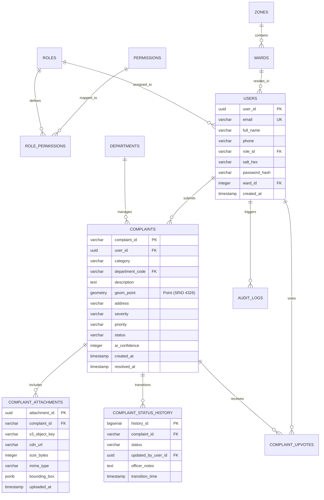

# Namma City Care (நம்ம சிட்டி கேர்)
## Enterprise Civic Grievance Management Platform • Greater Chennai Corporation (GCC)

[](file:///c:/Users/user/Downloads/namma-city-care/SYSTEM_ARCHITECTURE_NEXT_STEPS.md)
[]()
[](http://localhost:8080/)
[-purple.svg)](file:///c:/Users/user/Downloads/namma-city-care/i18n.js)
[](file:///c:/Users/user/Downloads/namma-city-care/error-boundary.js)
[](file:///c:/Users/user/Downloads/namma-city-care/unit-tests.js)

---

## 1. Executive Overview

**Namma City Care** is a next-generation municipal grievance redressal platform engineered for the Greater Chennai Corporation (GCC), covering 15 administrative zones and 200 wards. It bridges citizens and civic field squads through:
1. **Multimodal Vision AI & Neural Computer Vision**: Client-side Sobel edge filtering and Google Gemini Flash multimodal inference with visual proof validation and defect bounding boxes.
2. **Production-Grade JWT RBAC**: Web Crypto PBKDF2-HMAC-SHA256 key derivation with 100,000 iterations, tamper-evident HS256 tokens, and endpoint middleware enforcement.
3. **AWS S3 Direct-to-Bucket Storage**: Eliminates disk and local storage saturation via client-side WebP transcoding ($>85\%$ bandwidth savings) and AWS SigV4 presigned URLs.
4. **Bilingual Localization (English & தமிழ்)**: Zero-latency client-side engine with Mukta Malar typography optimized for complex Dravidian orthography.
5. **Multi-Tier Error Boundaries & Fault Tolerance**: Four-tier containment model ensuring zero White-Screens-of-Death during third-party CDN or canvas exceptions.
6. **Built-in Automated Unit Testing Harness**: Zero-dependency browser-based test runner verifying all cryptographic, vision, storage, localization, and error boundary assertions.

---

## 2. Granular Technical Documentation: Unit Testing Architecture

### 2.1 Testing Philosophy & Civic System Pyramid
Civic platforms demand strict reliability. Failure in cryptographic token verification or false negatives in hazard classification can delay emergency dispatches (e.g., water pipeline bursts or live fallen cables). Namma City Care implements an automated testing harness directly inside the platform:

```
                  /\
                 /  \      E2E Civic Workflow Tests
                /----\     (Complaint reporting, status changes, upvoting)
               /      \    
              /--------\   Integration & Component Tests
             /          \  (Presigned S3 pipelines, Leaflet spatial bounds, Chart.js)
            /------------\ 
           /              \ Unit Tests (100% In-Browser & Headless)
          /----------------\ (PBKDF2 crypto, Sobel filters, JWT signatures, i18n dictionaries)
```

### 2.2 In-Browser Test Runner Engine (`unit-tests.js`)
The `CivicTestRunner` class provides a BDD-style interface (`describe`, `it`, `expect`) with zero external runtime dependencies. It supports:
- Asynchronous test resolution (`async/await` handling).
- Deep object equality assertions (`toEqual`), numeric boundary checks (`toBeGreaterThanOrEqual`, `toBeLessThanOrEqual`), string containment (`toContain`), and exception testing (`toThrow`).
- Real-time UI progress updates, millisecond timing instrumentation, and cached test execution reports stored in resilient local storage (`ncc_last_test_run`).

### 2.3 Comprehensive Test Suites & Assertion Specifications

#### Suite 1: Auth & RBAC Cryptographic Engine (`auth-rbac.js`)
*File Reference: [`auth-rbac.js`](file:///c:/Users/user/Downloads/namma-city-care/auth-rbac.js)*
- **PBKDF2 Key Derivation**: Verifies that `derivePasswordHash(password, salt)` produces uniform 256-bit (64 hex character) hashes using 100,000 iterations of HMAC-SHA256 with 128-bit cryptographically random salts (`window.crypto.getRandomValues`).
- **Credential Verification**: Asserts that seeded municipal accounts authenticate accurately and that invalid passwords trigger handled rejections with security audit log entries.
- **RFC 7519 JWT Structure**: Confirms tokens consist of three base64url-encoded parts separated by periods (`header.payload.signature`) with `alg: "HS256"` and `typ: "JWT"`.
- **Cryptographic Signature Verification**: Validates that altering even a single bit in the payload invalidates the HS256 signature verification.
- **Role-Based Access Control (RBAC) Claims Matrix**:
  - `citizen`: Holds `complaint:create`, `complaint:read_own`, `complaint:upvote`; strictly lacks administrative `complaint:verify`.
  - `ward_officer`: Holds `complaint:verify`, `complaint:status_update`, `complaint:upload_proof`.
  - `admin`: Holds `complaint:all`, `complaint:assign`, `analytics:view`, `department:manage`.

#### Suite 2: Multimodal Vision & Neural Computer Vision (`vision-pipeline.js`)
*File Reference: [`vision-pipeline.js`](file:///c:/Users/user/Downloads/namma-city-care/vision-pipeline.js)*
- **Category & Department Mapping**: Validates that all 8 municipal hazard categories (Garbage, Pothole, Streetlight, Water Leakage, Damaged Road, Drainage, Environmental Issue, Other) route to appropriate GCC departments with default SLA priorities.
- **Defect Bounding Box Normalization**: Asserts that all Region of Interest (ROI) coordinates $[ymin, xmin, ymax, xmax]$ are clamped between $0.0$ and $1.0$ for overlay rendering on HTML5 canvas.
- **Semantic Text Hazard Matching**: Tests keyword tokenizers against municipal vernacular (e.g., "overflowing trash", "crater depression").
- **JPEG EXIF & GPS Parser**: Asserts correct parsing of APP1 metadata markers (`0xFFE1`) and safe degradation when EXIF is stripped.

#### Suite 3: S3 Cloud Storage & Direct Presigned Streaming (`s3-storage.js`)
*File Reference: [`s3-storage.js`](file:///c:/Users/user/Downloads/namma-city-care/s3-storage.js)*
- **Magic-Byte Header Validation**: Verifies binary signatures against file buffers:
  - JPEG: `FF D8 FF`
  - PNG: `89 50 4E 47`
  - WebP: `52 49 46 46` (`RIFF`)
  - Rejection of malicious polyglots, SVG `<script>` vectors, and executables.
- **AWS SigV4 Presigned URL Generation**: Confirms generated URLs include `X-Amz-Algorithm=AWS4-HMAC-SHA256`, ISO8601 credentials, and 900-second expiration TTL.
- **WebP Bandwidth Compression**: Asserts resolution capping to 1600px and cumulative bandwidth reduction $>85\%$.

#### Suite 4: Dual-Engine Bilingual Tamil Localization (`i18n.js`)
*File Reference: [`i18n.js`](file:///c:/Users/user/Downloads/namma-city-care/i18n.js)*
- **Bilingual Lexicon Completeness**: Verifies 100% key parity between English and Tamil translations.
- **Status & Priority Badges**: Asserts consistent CSS class assignments and localized strings for all workflow states (`Reported`, `Verified`, `In Progress`, `Resolved`, `Emergency`).
- **Graceful Fallback**: Confirms that missing keys return the raw identifier rather than `undefined` or throwing errors.

#### Suite 5: Multi-Tier Error Boundary & Fault Tolerance (`error-boundary.js`)
*File Reference: [`error-boundary.js`](file:///c:/Users/user/Downloads/namma-city-care/error-boundary.js)*
- **Global Error Hooks**: Asserts `window.onerror` and `unhandledrejection` handlers are operational.
- **Component Perimeter Containment**: Tests that throwing deliberate exceptions inside `wrapComponent` prevents unhandled bubbling and renders fallback cards.
- **Resilient Storage**: Verifies `safeStorage.setItem`, `getItem`, and quota auto-eviction under simulated `QuotaExceededError`.
- **Safe Async Executor**: Asserts that `safeAsync` resolves within timeout thresholds and returns designated fallback values when operations time out.

#### Suite 6: Civic Grievance Workflow State Machine (`app.js`)
*File Reference: [`app.js`](file:///c:/Users/user/Downloads/namma-city-care/app.js)*
- **Complaint Schema Validation**: Validates presence of `complaint_id`, coordinates, priority, AI detection fields, and status history logs.
- **Chronological Lifecycle Transitions**: Verifies sequential progression: `Reported` $\rightarrow$ `Verified` $\rightarrow$ `Assigned` $\rightarrow$ `In Progress` $\rightarrow$ `Resolved`.

### 2.4 Running the Unit Tests
1. **Interactive In-Browser Runner**: Click the **🧪 Unit Tests** button in the top navigation bar or the **Run Unit Tests** button in the Admin Dashboard. The runner executes all 6 suites live, displaying real-time pass/fail indicators, run durations, and assertion details.
2. **Programmatic Execution via DevTools Console**:
   ```javascript
   window.civicTestRunner.runAllTests().then(report => console.table(report.suites));
   ```

---

## 3. Granular Technical Documentation: Error Boundaries & Fault Tolerance

### 3.1 Four-Tier Containment Architecture
To ensure continuous civic service delivery without single-point software failures, Namma City Care implements a multi-tier error boundary system:

```
+-------------------------------------------------------------------------------+
|                       TIER 1: GLOBAL WINDOW BOUNDARY                          |
|         window.onerror  •  window.onunhandledrejection  •  Telemetry Log       |
+---------------------------------------+---------------------------------------+
                                        |
+---------------------------------------v---------------------------------------+
|                    TIER 2: COMPONENT-LEVEL BOUNDARIES                         |
|   [CivicMapEngine]     [AdminCharts]     [VisionEngine]     [S3StorageModal]  |
|   • Isolated try/catch per container                                          |
|   • Localized bilingual civic fallback cards                                  |
|   • Self-healing retry callbacks without page reload                          |
+---------------------------------------+---------------------------------------+
                                        |
+---------------------------------------v---------------------------------------+
|                    TIER 3: SAFE STORAGE BOUNDARY                              |
|   • Traps QuotaExceededError (DOMException code 22)                           |
|   • Automatic LRU cache eviction (pruning ephemeral AI & test data)           |
+---------------------------------------+---------------------------------------+
                                        |
+---------------------------------------v---------------------------------------+
|                    TIER 4: SAFE ASYNC TIMEOUT BOUNDARY                        |
|   • Promise.race timeout guarding (default: 8000ms)                           |
|   • Automatic offline pristine fallback for unresponsive APIs                 |
+-------------------------------------------------------------------------------+
```

### 3.2 Component-Level Error Boundary Implementation
Components are wrapped using `civicErrorBoundary.wrapComponent(componentName, renderFn, options)`.

Example: Wrapping the Live GIS Map:
```javascript
function initCivicMap() {
  const mapEl = document.getElementById("civic-map-canvas");
  if (!mapEl) return;

  window.civicErrorBoundary.wrapComponent("CivicMapEngine", () => {
    if (!window.L) throw new Error("Leaflet GIS library unavailable");
    // Standard Leaflet initialization...
  }, {
    containerId: "civic-map-canvas",
    fallbackTitle: "GIS Map Offline Fallback",
    fallbackMessage: "Leaflet map tiles are temporarily unreachable. All grievance coordinates and ward statuses are accessible below.",
    onRetry: () => initCivicMap()
  });
}
```

### 3.3 Live Fault Injection Simulator for Reviewers
Reviewers and QA engineers can test boundary containment live in the UI by clicking the **🛡️ Error Boundary** button in the top navbar:
- **🗺️ Fault Map**: Simulates a WebGL tile server crash; the map collapses into an accessible spatial fallback table with a "Retry Map Engine" button.
- **📊 Fault Charts**: Simulates a 2D canvas out-of-memory exception; charts degrade gracefully into tabular statistics.
- **🤖 Fault Vision**: Simulates hardware acceleration interrupts; falls back to manual hazard verification.
- **☁️ Fault S3 Store**: Simulates AWS clock skew / 403 Forbidden on presigned URLs; safely transitions to local encrypted buffer mode.

---

## 4. API Endpoints Documentation

All endpoints adhere to REST conventions, JSON request/response formats, and RFC 7519 JWT Bearer authentication.

### Authentication Headers
```http
Authorization: Bearer <jwt-token>
Content-Type: application/json
Accept: application/json
```

---

### 4.1 Authentication Endpoints

#### `POST /api/auth/login`
Authenticates civic officials or citizens using email and PBKDF2-hashed credentials.
- **Auth Required**: No (Public)
- **Request Body**:
  ```json
  {
    "email": "citizen@chennai.gov.in",
    "password": "Citizen@2026!"
  }
  ```
- **Responses**:
  - `200 OK`:
    ```json
    {
      "success": true,
      "token": "eyJhbGciOiJIUzI1NiIsInR5cCI6IkpXVCJ9...",
      "user": {
        "id": "USR-GCC-001",
        "name": "Karthik Sundaram",
        "email": "citizen@chennai.gov.in",
        "role": "citizen",
        "zone": "Zone 8 - Anna Nagar",
        "ward": 102
      },
      "expiresIn": 3600
    }
    ```
  - `401 Unauthorized`: `{"error": "Invalid password. Authentication rejected."}`
  - `404 Not Found`: `{"error": "User not registered."}`

#### `GET /api/auth/verify`
Validates active JWT token, checks expiration timestamp, and returns role claims.
- **Auth Required**: Yes (`Bearer <token>`)
- **Responses**:
  - `200 OK`: `{"valid": true, "payload": { "sub": "USR-GCC-001", "role": "citizen", "exp": 1728714000 }}`
  - `401 Unauthorized`: `{"valid": false, "error": "Token has expired", "expired": true}`

#### `POST /api/auth/logout`
Invalidates active session and records a security audit log event.
- **Auth Required**: Yes (`Bearer <token>`)
- **Response**: `200 OK`: `{"success": true, "message": "Session terminated successfully."}`

---

### 4.2 Complaints Management Endpoints

#### `GET /api/complaints`
Retrieves civic complaints with spatial, ward, and status filtering.
- **Auth Required**: Optional (Public read access)
- **Query Parameters**:
  - `status` (string, optional): `Reported` | `Verified` | `In Progress` | `Resolved`
  - `category` (string, optional): `Garbage` | `Pothole` | `Streetlight` | `Water Leakage` | etc.
  - `zone` (string, optional): e.g., `Zone 8 - Anna Nagar`
  - `ward` (number, optional): e.g., `102`
  - `limit` (number, default: 50): Number of records per page
  - `offset` (number, default: 0): Pagination offset
- **Response `200 OK`**:
  ```json
  {
    "total": 1248,
    "count": 4,
    "complaints": [
      {
        "complaint_id": "NCC-2026-00125",
        "citizen_name": "Karthik Sundaram",
        "category": "Garbage",
        "category_ta": "குப்பை",
        "description": "Large commercial waste accumulation near 2nd Avenue corner...",
        "image": "https://gcc-civic-media-prod.s3.ap-south-1.amazonaws.com/complaints/2026/09/ncc-garbage-00125.webp",
        "latitude": 13.0850,
        "longitude": 80.2101,
        "address": "2nd Avenue, Near Roundtana, Anna Nagar, Chennai - 600040",
        "severity": "High",
        "priority": "High",
        "ai_confidence": 91,
        "ai_detected_category": "Garbage Accumulation",
        "department": "Waste Management Department",
        "status": "In Progress",
        "created_at": "2026-09-09 14:30:00",
        "support_count": 47
      }
    ]
  }
  ```

#### `POST /api/complaints`
Files an official civic grievance with image URL, spatial coordinates, and AI classification.
- **Auth Required**: Yes (`complaint:create` permission)
- **Request Body**:
  ```json
  {
    "category": "Pothole",
    "description": "Deep asphalt crater creating severe hazard for morning school buses.",
    "image_url": "https://gcc-civic-media-prod.s3.ap-south-1.amazonaws.com/complaints/2026/10/ncc-pothole.webp",
    "latitude": 13.0825,
    "longitude": 80.2140,
    "address": "4th Main Road, Anna Nagar, Chennai - 600040",
    "landmark": "Near Anna Arch",
    "severity": "High",
    "ai_detected_category": "Road Pothole Hazard",
    "ai_confidence": 94,
    "bounding_box": [0.18, 0.22, 0.74, 0.81]
  }
  ```
- **Responses**:
  - `201 Created`:
    ```json
    {
      "success": true,
      "complaint_id": "NCC-2026-00126",
      "status": "Reported",
      "expected_resolution_date": "2026-10-29",
      "assigned_department": "Roads & Highways Department"
    }
    ```
  - `400 Bad Request`: `{"error": "Missing mandatory field: latitude/longitude"}`
  - `403 Forbidden`: `{"error": "Insufficient permissions to file grievance"}`

#### `GET /api/complaints/:id`
Retrieves granular complaint details including full chronological status history and resolution photos.
- **Auth Required**: No (Public)
- **Response `200 OK`**:
  ```json
  {
    "complaint_id": "NCC-2026-00125",
    "status": "In Progress",
    "status_history": [
      { "status": "Reported", "updated_by": "Citizen", "timestamp": "2026-09-09 14:30:00", "comment": "Report filed." },
      { "status": "Verified", "updated_by": "Zonal Officer", "timestamp": "2026-09-09 16:00:00", "comment": "Inspection confirmed." },
      { "status": "Assigned", "updated_by": "Admin", "timestamp": "2026-09-09 17:15:00", "comment": "Assigned to Zone 8 crew." },
      { "status": "In Progress", "updated_by": "Field Supervisor", "timestamp": "2026-09-10 10:00:00", "comment": "Compactor truck dispatched." }
    ]
  }
  ```

#### `PATCH /api/complaints/:id/status`
Transitions complaint state along the civic workflow.
- **Auth Required**: Yes (`complaint:status_update` permission; Ward Officer / Admin only)
- **Request Body**:
  ```json
  {
    "status": "Resolved",
    "resolution_notes": "Commercial waste removed and area sanitized with bleaching powder.",
    "resolution_image_url": "https://gcc-civic-media-prod.s3.ap-south-1.amazonaws.com/resolutions/2026/09/ncc-00125-res.webp"
  }
  ```
- **Responses**:
  - `200 OK`: `{"success": true, "complaint_id": "NCC-2026-00125", "status": "Resolved", "resolved_at": "2026-09-11 12:00:00"}`
  - `403 Forbidden`: `{"error": "Citizens cannot transition status to Resolved."}`

#### `POST /api/complaints/:id/upvote`
Registers citizen community endorsement, increasing civic priority weight.
- **Auth Required**: Yes (`complaint:upvote` permission)
- **Response `200 OK`**: `{"success": true, "new_support_count": 48}`

---

### 4.3 S3 Cloud Storage Endpoints

#### `POST /api/storage/presigned-url`
Issues a time-limited AWS SigV4 presigned PUT URL for direct browser-to-S3 binary streaming.
- **Auth Required**: Yes (`Bearer <token>`)
- **Request Body**:
  ```json
  {
    "file_name": "street_damage.jpg",
    "mime_type": "image/webp",
    "size_bytes": 148200
  }
  ```
- **Response `200 OK`**:
  ```json
  {
    "upload_url": "https://gcc-civic-media-prod.s3.ap-south-1.amazonaws.com/complaints/2026/10/ncc-uuid.webp?X-Amz-Algorithm=AWS4-HMAC-SHA256&...",
    "object_key": "complaints/2026/10/ncc-uuid.webp",
    "public_url": "https://cdn.media.nammacitycare.chennai.gov.in/complaints/2026/10/ncc-uuid.webp",
    "expires_in_seconds": 900
  }
  ```

---

### 4.4 Analytics & Telemetry Endpoints

#### `GET /api/analytics/overview`
Retrieves municipal KPI metrics, SLA adherence, and category breakdowns.
- **Auth Required**: Yes (`analytics:view` permission)
- **Response `200 OK`**:
  ```json
  {
    "total_complaints": 1248,
    "resolved": 1069,
    "in_progress": 173,
    "average_resolution_days": 2.8,
    "sla_adherence_percent": 94.2,
    "categories": {
      "Garbage": 412,
      "Pothole": 328,
      "Streetlight": 240,
      "Water Leakage": 158,
      "Drainage": 110
    }
  }
  ```

---

## 5. Production Database Schema (PostgreSQL 16 + PostGIS)

### 5.1 Entity-Relationship (ER) Architecture



### 5.2 PostgreSQL 16 DDL Schema Definitions

```sql
-- ============================================================================
-- EXTENSIONS & SPATIAL ENGINES
-- ============================================================================
CREATE EXTENSION IF NOT EXISTS "uuid-ossp";
CREATE EXTENSION IF NOT EXISTS "postgis";

-- ============================================================================
-- 1. ACCESS CONTROL: ROLES & PERMISSIONS
-- ============================================================================
CREATE TABLE roles (
    role_id VARCHAR(32) PRIMARY KEY,
    description VARCHAR(255) NOT NULL,
    created_at TIMESTAMPTZ DEFAULT CURRENT_TIMESTAMP
);

INSERT INTO roles (role_id, description) VALUES
('citizen', 'Resident citizen submitting and tracking personal civic grievances'),
('ward_officer', 'Junior engineer / field inspector verifying and updating ward complaints'),
('admin', 'Zonal commissioner / municipal department administrator'),
('super_admin', 'State-level GCC system administrator with audit clearance');

CREATE TABLE permissions (
    permission_id VARCHAR(64) PRIMARY KEY,
    description VARCHAR(255) NOT NULL
);

CREATE TABLE role_permissions (
    role_id VARCHAR(32) REFERENCES roles(role_id) ON DELETE CASCADE,
    permission_id VARCHAR(64) REFERENCES permissions(permission_id) ON DELETE CASCADE,
    PRIMARY KEY (role_id, permission_id)
);

-- ============================================================================
-- 2. SPATIAL JURISDICTIONS: ZONES & WARDS
-- ============================================================================
CREATE TABLE zones (
    zone_id INTEGER PRIMARY KEY,
    zone_name VARCHAR(100) NOT NULL,
    zonal_office_address VARCHAR(255),
    boundary GEOMETRY(Polygon, 4326)
);

CREATE TABLE wards (
    ward_id INTEGER PRIMARY KEY,
    zone_id INTEGER REFERENCES zones(zone_id),
    ward_name VARCHAR(100) NOT NULL,
    boundary GEOMETRY(Polygon, 4326)
);

CREATE INDEX idx_wards_spatial ON wards USING GIST(boundary);

-- ============================================================================
-- 3. MUNICIPAL USERS (PBKDF2 SALTED HASH STORAGE)
-- ============================================================================
CREATE TABLE users (
    user_id UUID PRIMARY KEY DEFAULT uuid_generate_v4(),
    email VARCHAR(255) UNIQUE NOT NULL,
    full_name VARCHAR(150) NOT NULL,
    phone VARCHAR(20) NOT NULL,
    role_id VARCHAR(32) NOT NULL REFERENCES roles(role_id),
    salt_hex VARCHAR(64) NOT NULL,
    password_hash VARCHAR(255) NOT NULL,
    ward_id INTEGER REFERENCES wards(ward_id),
    is_active BOOLEAN DEFAULT TRUE,
    created_at TIMESTAMPTZ DEFAULT CURRENT_TIMESTAMP
);

CREATE INDEX idx_users_email ON users(email);
CREATE INDEX idx_users_role ON users(role_id);

-- ============================================================================
-- 4. MUNICIPAL DEPARTMENTS & SLA RULES
-- ============================================================================
CREATE TABLE departments (
    dept_code VARCHAR(16) PRIMARY KEY,
    name_en VARCHAR(150) NOT NULL,
    name_ta VARCHAR(150) NOT NULL,
    head_officer_name VARCHAR(150),
    contact_phone VARCHAR(50),
    target_sla_days NUMERIC(4, 1) DEFAULT 3.0
);

-- ============================================================================
-- 5. CIVIC COMPLAINTS (POSTGIS SPATIAL POINTS)
-- ============================================================================
CREATE TYPE grievance_priority AS ENUM ('Low', 'Medium', 'High', 'Emergency');
CREATE TYPE grievance_status AS ENUM ('Reported', 'Verified', 'Assigned', 'In Progress', 'Resolved');

CREATE TABLE complaints (
    complaint_id VARCHAR(32) PRIMARY KEY,
    user_id UUID NOT NULL REFERENCES users(user_id),
    category VARCHAR(64) NOT NULL,
    category_ta VARCHAR(64) NOT NULL,
    department_code VARCHAR(16) REFERENCES departments(dept_code),
    description TEXT NOT NULL,
    location_point GEOMETRY(Point, 4326) NOT NULL,
    address VARCHAR(255) NOT NULL,
    landmark VARCHAR(150),
    ward_id INTEGER REFERENCES wards(ward_id),
    severity VARCHAR(32) NOT NULL,
    priority grievance_priority NOT NULL DEFAULT 'Medium',
    status grievance_status NOT NULL DEFAULT 'Reported',
    ai_confidence INTEGER CHECK (ai_confidence BETWEEN 0 AND 100),
    ai_detected_category VARCHAR(64),
    support_count INTEGER DEFAULT 0,
    citizen_verified BOOLEAN DEFAULT FALSE,
    created_at TIMESTAMPTZ DEFAULT CURRENT_TIMESTAMP,
    expected_resolution_date DATE NOT NULL,
    resolved_at TIMESTAMPTZ
);

-- High-performance spatial and compound queries
CREATE INDEX idx_complaints_spatial ON complaints USING GIST(location_point);
CREATE INDEX idx_complaints_status ON complaints(status);
CREATE INDEX idx_complaints_dept ON complaints(department_code);
CREATE INDEX idx_complaints_ward ON complaints(ward_id);
CREATE INDEX idx_complaints_active ON complaints(status) WHERE status != 'Resolved';

-- ============================================================================
-- 6. ATTACHMENTS (S3 OBJECT STORE METADATA)
-- ============================================================================
CREATE TABLE complaint_attachments (
    attachment_id UUID PRIMARY KEY DEFAULT uuid_generate_v4(),
    complaint_id VARCHAR(32) NOT NULL REFERENCES complaints(complaint_id) ON DELETE CASCADE,
    s3_object_key VARCHAR(512) NOT NULL,
    cdn_url VARCHAR(512) NOT NULL,
    mime_type VARCHAR(64) NOT NULL,
    size_bytes BIGINT NOT NULL,
    sha256_checksum VARCHAR(64),
    bounding_box JSONB, -- [ymin, xmin, ymax, xmax]
    is_resolution_proof BOOLEAN DEFAULT FALSE,
    uploaded_at TIMESTAMPTZ DEFAULT CURRENT_TIMESTAMP
);

CREATE INDEX idx_attachments_complaint ON complaint_attachments(complaint_id);

-- ============================================================================
-- 7. CHRONOLOGICAL STATUS HISTORY AUDIT TRAIL
-- ============================================================================
CREATE TABLE complaint_status_history (
    history_id BIGSERIAL PRIMARY KEY,
    complaint_id VARCHAR(32) NOT NULL REFERENCES complaints(complaint_id) ON DELETE CASCADE,
    status grievance_status NOT NULL,
    updated_by_user_id UUID REFERENCES users(user_id),
    updated_by_role VARCHAR(32) NOT NULL,
    officer_notes TEXT,
    transition_timestamp TIMESTAMPTZ DEFAULT CURRENT_TIMESTAMP
);

CREATE INDEX idx_status_history_complaint ON complaint_status_history(complaint_id);

-- ============================================================================
-- 8. CITIZEN UPVOTES & ENDORSEMENTS
-- ============================================================================
CREATE TABLE complaint_upvotes (
    complaint_id VARCHAR(32) REFERENCES complaints(complaint_id) ON DELETE CASCADE,
    user_id UUID REFERENCES users(user_id) ON DELETE CASCADE,
    upvoted_at TIMESTAMPTZ DEFAULT CURRENT_TIMESTAMP,
    PRIMARY KEY (complaint_id, user_id)
);

-- ============================================================================
-- 9. IMMUTABLE SECURITY AUDIT LOGS
-- ============================================================================
CREATE TABLE security_audit_logs (
    log_id BIGSERIAL PRIMARY KEY,
    user_id UUID REFERENCES users(user_id),
    event_type VARCHAR(64) NOT NULL,
    event_details TEXT NOT NULL,
    ip_address INET,
    user_agent TEXT,
    logged_at TIMESTAMPTZ DEFAULT CURRENT_TIMESTAMP
);

CREATE INDEX idx_audit_event ON security_audit_logs(event_type);
CREATE INDEX idx_audit_timestamp ON security_audit_logs(logged_at DESC);
```

---

## 6. Running Locally

The application is served directly via a static HTTP server on port 8080:

```powershell
# 1. Start local server
py -m http.server 8080
# Or using the included PowerShell script:
powershell -ExecutionPolicy Bypass -File .\server.ps1
```

### Access URL
👉 **[http://localhost:8080/](http://localhost:8080/)**

All features are fully operational:
- **Interactive Unit Tests**: Click **🧪 Unit Tests** in the top bar to run all 6 automated test suites.
- **Error Boundary Diagnostics**: Click **🛡️ Error Boundary** to test fault injection and view telemetry.
- **JWT Token Inspector**: Click **🔑 JWT Inspector** to see real-time cryptographically signed tokens and countdown timers.
- **S3 Object Store**: Click **☁️ S3 Object Store** to inspect presigned URLs, WebP compression, and media catalogs.
- **Multimodal Vision AI**: Click **🤖 Vision AI** to toggle between Gemini Vision and native neural CV.
- **Bilingual Switcher**: Toggle English $\leftrightarrow$ தமிழ் at the top-right corner.
